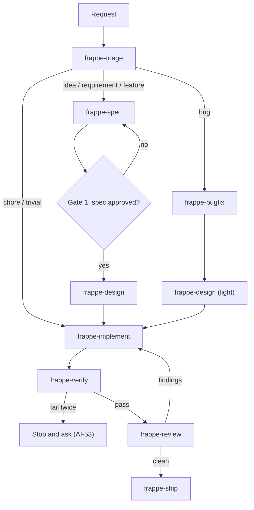

# Frappe Delivery Orchestrator

Takes a raw request from zero to done. Governance lives in `context/` (read it first — AI-01); this skill
sequences the phase skills and enforces gates from `.agents/rules/00-delivery-gates.md`.

## Flow



## Procedure

1. **Create a task checklist** (one item per phase) and keep it updated.
2. Read `context/` per its README reading order (skip files already read this session).
3. Invoke `frappe-triage`; follow its routing. Read each phase skill's `SKILL.md` when you reach it.
4. At each gate, **stop and present** the artifact (spec / design summary / diff summary) and wait.
5. Delegate where it helps (see `.agents/agents/README.md`): independent review and QA roles give fresher
   eyes than self-review. Parallelize only read-only work (research, review); one engineer writes code.
6. Finish only when the Definition of Done in `00-delivery-gates.md` is satisfied.

## Autonomy levels

| Request signal | Mode |
| :-- | :-- |
| "just fix X" + trivial, clear cause | Skip spec; still reproduce → test → fix → verify |
| Normal feature/bug | Full flow, gates 1 and 3 |
| Touches schema, money/stock ledgers, permissions, guest access | Full flow + gate 2 + security reviewer |
| Vague idea ("we should maybe…") | Triage + spec only; stop at Gate 1 |

## Final report template
```
Outcome: <one line>
Changed: <files/links>   Spec: <link + status>
Verified: <exact commands + results>   Not verified: <list>
You must: <migrate / restart / approve / push>
Risks & follow-ups: <list>
```

