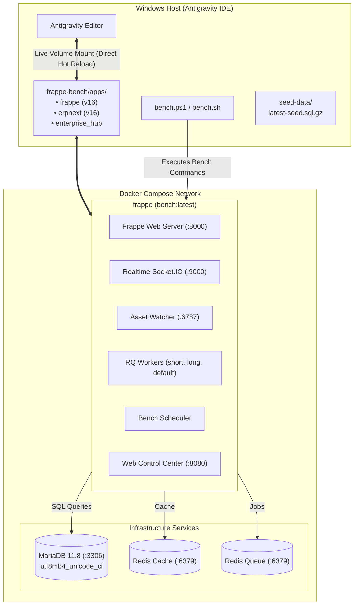
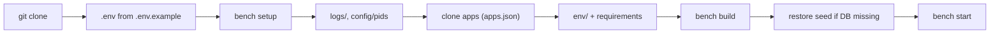

# Frappe & ERPNext v16 Enterprise Development Stack

Enterprise-grade, Docker-first development environment for **Frappe Framework v16** and **ERPNext v16**, optimized for local development with **Antigravity IDE** on Windows and cross-machine state synchronization via GitHub.

---

## 🏛️ System Architecture



---

## 🚀 Quick Access Endpoints

| Service | Host URL | Description |
| :--- | :--- | :--- |
| **Frappe & ERPNext Desk** | [http://localhost:8000](http://localhost:8000) | Main ERP & Framework Web UI (`Administrator` / `admin`) |
| **Realtime Socket.IO** | [http://localhost:9000](http://localhost:9000) | Live events, notifications, and document sync |
| **Web Control Center** | [http://localhost:8080](http://localhost:8080) | GUI for backups, workers, schedulers, and Redis |
| **MariaDB Server** | `127.0.0.1:3306` | External SQL tools connection (`root` / `123`) |
| **Mailpit (dev mail catcher)** | [http://localhost:8025](http://localhost:8025) | Every email sent to an external address in dev lands here (F-006) |
| **Stalwart Mail Admin** | [http://localhost:8090](http://localhost:8090) | Mail server admin (`admin` / `MAIL_ADMIN_PASSWORD` from `.env`) |
| **SMTP / IMAP** | `127.0.0.1:465` / `127.0.0.1:993` | Mailboxes `notifications@hub.localhost`, `support@hub.localhost` (F-006) |

---

## 🛠️ Management CLI (`bench.ps1` & `bench.sh`)

Use the included PowerShell helper script `.\bench.ps1` (or `./bench.sh` on Linux/macOS/WSL) for all day-to-day operations:

### Stack Lifecycle
```powershell
.\bench.ps1 up            # Start all Docker containers
.\bench.ps1 down          # Stop all Docker containers
.\bench.ps1 ps            # View container health and ports
.\bench.ps1 bash          # Drop into bash terminal inside frappe container
```

### Dev Server & Workers
```powershell
.\bench.ps1 start -d      # Start dev server (web, socketio, watch, schedule, workers) in background
.\bench.ps1 stop          # Stop dev server and background processes
.\bench.ps1 restart       # Restart dev server
.\bench.ps1 worker restart# Restart RQ workers
.\bench.ps1 worker status # Check RQ queue doctor status
```

### Database & Cross-Machine State Sync
```powershell
.\bench.ps1 backup        # Create timestamped site backup (with files)
.\bench.ps1 export-seed   # Export latest DB dump to seed-data/latest-seed.sql.gz
.\bench.ps1 restore-seed  # Restore seed-data/latest-seed.sql.gz into MariaDB
```

### Apps & Sites
```powershell
.\bench.ps1 new-app my_app            # Create a new custom Frappe app
.\bench.ps1 install-app my_app        # Install custom app on site
.\bench.ps1 uninstall-app my_app      # Uninstall app from site
.\bench.ps1 migrate                   # Run database schema migrations
.\bench.ps1 console                   # Open interactive Frappe Python console
```

### Cache & Telemetry
```powershell
.\bench.ps1 redis flush               # Flush Redis cache & job queues
.\bench.ps1 redis info                # View Redis memory statistics
.\bench.ps1 logs                      # View live output from dev server
.\bench.ps1 dashboard                 # Launch Web Control Center on port 8080
```

---

## 💻 Developing Inside Antigravity (Shared Volume)

Because Antigravity runs directly on your Windows host:
1. Open the root workspace directory in Antigravity.
2. Navigate to `frappe-bench/apps/`:
   - `frappe-bench/apps/frappe/` — Core framework (v16)
   - `frappe-bench/apps/erpnext/` — ERPNext application (v16)
   - `frappe-bench/apps/enterprise_hub/` — Your custom app
3. Any edits made in Antigravity to Python, JavaScript, Vue, or JSON files are immediately reflected inside the Docker container with **instant hot-reloading**.

---

## 📦 Publishing Custom Apps to GitHub

Each custom app created in `frappe-bench/apps/<app_name>` is an independent Git repository:

```powershell
cd frappe-bench/apps/enterprise_hub
git remote add origin https://github.com/<your-username>/enterprise_hub.git
git branch -M version-16
git push -u origin version-16
```

---

## 🔄 Sharing Your Setup & Database State with Another Machine (Home PC)

### On Your Work Machine (Exporting State):
```powershell
# 1. Export active site snapshot to seed-data/
.\bench.ps1 export-seed

# 2. Commit and push bench configuration and snapshot
git add seed-data/ apps.json docker-compose.yml bench.ps1
git commit -m "chore(db): update bench seed snapshot"
git push origin main
```

### On Your Home PC (Restoring State):
```powershell
# 1. Clone this repository
git clone https://github.com/<your-username>/frappe-dev-stack.git
cd frappe-dev-stack

# 2. Copy environment settings
Copy-Item .env.example .env

# 3. Bootstrap the bench (idempotent; safe to re-run)
#    Starts the stack, clones frappe + every app in apps.json, creates env/,
#    installs python/node deps, builds assets, restores the seed DB if missing.
.\bench.ps1 setup          # Linux/macOS/WSL: ./bench.sh setup

# 4. Start dev server
.\bench.ps1 start -d
```



> [!IMPORTANT]
> `frappe-bench/apps/`, `env/`, `logs/`, `config/` and `sites/assets/` are git-ignored, so a fresh clone
> cannot start until `setup` has run (`start` checks this and tells you). Every custom app must have a
> pushed git remote and a `"url"` in [`apps.json`](apps.json), otherwise `setup` stops with an error.
>
> On a **Linux** host the container runs as uid 1000; if your user differs, run
> `sudo chown -R 1000:1000 frappe-bench` once before `setup`.

All your DocTypes, database records, and settings are replicated within seconds!
