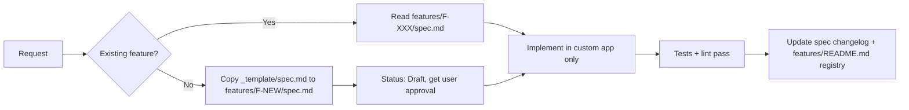

# 🧠 AI Context Directory

> Single source of truth for AI agents (and humans) working on this repository.
> **Every AI session MUST read this directory before writing code.**

## 📂 Layout

```text
context/
├── README.md                ← You are here (index + reading order)
├── project-overview.md      ← System presentation, architecture diagrams, main features
├── ai-rules.md              ← Behavioural guardrails for AI agents (MUST obey)
├── technical-rules.md       ← Frappe / ERPNext v16 engineering standards
└── features/
    ├── README.md            ← Feature registry (status of every feature)
    ├── _template/spec.md    ← Copy this to start a new feature
    └── F-XXX-<slug>/spec.md ← One spec per feature
```

## 📖 Mandatory Reading Order

| # | File | When |
| :-- | :--- | :--- |
| 1 | [ai-rules.md](./ai-rules.md) | Always, first |
| 2 | [project-overview.md](./project-overview.md) | Always |
| 3 | [technical-rules.md](./technical-rules.md) | Before writing/reviewing any code |
| 4 | [features/README.md](./features/README.md) | Before touching an existing feature or creating a new one |
| 5 | `features/F-XXX-*/spec.md` | The spec(s) of the feature(s) in scope |

## 🔁 Spec-Driven Workflow



## ✍️ Maintenance

- Docs are owned by the team; AI agents may **update** feature specs and the registry as part of a task.
- AI agents must **not** edit `ai-rules.md` or `technical-rules.md` unless explicitly asked.
- Keep everything Notion-exportable: plain Markdown, Mermaid diagrams, short sections.
