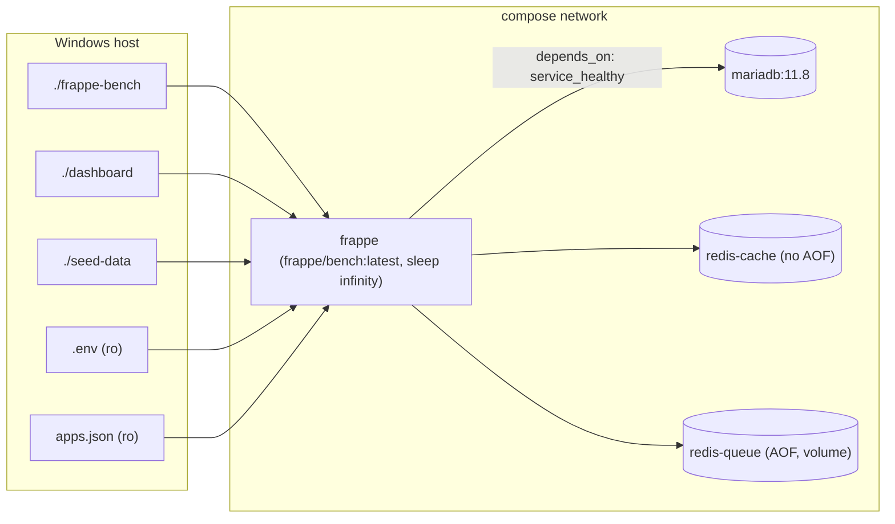

# F-001 — Docker Dev Stack

| Field | Value |
| :--- | :--- |
| **ID** | F-001 |
| **Status** | ⚠️ Implemented (debt) |
| **Owner** | Ahmad |
| **Area** | Infra |
| **Location** | [`docker-compose.yml`](../../../docker-compose.yml), [`.env.example`](../../../.env.example), [`apps.json`](../../../apps.json), [`frappe-bench/Procfile`](../../../frappe-bench/Procfile), `frappe-bench/sites/common_site_config.json` |
| **Depends on** | Docker Desktop (Windows) |
| **Created** | 2026-10-15 |
| **Last updated** | 2026-10-23 |

---

## 1. Summary

A reproducible, Docker-first runtime for Frappe v16 + ERPNext v16. Source code lives on the Windows host
and is bind-mounted into a `frappe/bench` container so edits in the IDE hot-reload instantly.

## 2. Goals / Non-goals

- **Goals:** one-command bring-up; parity across machines; isolated infra services; loopback-only exposure.
- **Non-goals:** production deployment (no Nginx, Gunicorn tuning, Supervisor, TLS, backups off-host).

## 3. Architecture

## 4. Services

| Service | Image | Ports (host loopback) | Persistence | Notes |
| :--- | :--- | :--- | :--- | :--- |
| `mariadb` | `mariadb:11.8` | `${MARIADB_PORT:-3306}` | `mariadb-data` volume | `utf8mb4_unicode_ci`, `innodb-file-per-table`, healthcheck `healthcheck.sh --connect --innodb_initialized` |
| `redis-cache` | `redis:alpine` | — | none (AOF off) | Volatile cache |
| `redis-queue` | `redis:alpine` | — | `redis-queue-data` volume (AOF on) | RQ jobs + Socket.IO pub/sub |
| `frappe` | `frappe/bench:latest` | `8000`, `9000`, `6787`, `8080` | bind mounts | Idle container (`sleep infinity`); processes started by F-002 via `honcho` |

### 4.1 Processes (Procfile, run by honcho)

| Process | Command |
| :--- | :--- |
| web | `bench serve --port 8000` |
| socketio | `bench socketio` |
| watch | `bench watch` |
| schedule | `bench schedule` |
| worker | `bench worker` (logs → `logs/worker*.log`) |

## 5. Configuration

| Variable (`.env`) | Default | Purpose |
| :--- | :--- | :--- |
| `FRAPPE_BRANCH` / `ERPNEXT_BRANCH` | `version-16` | Upstream branches |
| `SITE_NAME` | `development.localhost` | Primary dev site |
| `DB_HOST` / `DB_ROOT_PASSWORD` / `MARIADB_PORT` | `mariadb` / *(dev value)* / `3306` | Database |
| `REDIS_CACHE` / `REDIS_QUEUE` / `REDIS_SOCKETIO` | `redis://redis-*:6379` | Redis endpoints |
| `WEB_PORT` / `SOCKETIO_PORT` / `WATCHER_PORT` / `DASHBOARD_PORT` | `8000` / `9000` / `6787` / `8080` | Exposed ports |

`common_site_config.json` highlights: `developer_mode: 1`, `background_workers: 1`, `live_reload: true`,
`serve_default_site: true`, `default_site: development.localhost`.

## 6. Acceptance Criteria

| ID | Criterion |
| :-- | :--- |
| AC-1 | `.\bench.ps1 up` starts 4 containers; `mariadb` reports healthy. |
| AC-2 | Desk reachable on `http://localhost:8000` after `.\bench.ps1 start -d`. |
| AC-3 | Editing a `.py` file under `apps/enterprise_hub` is reflected without container restart. |
| AC-4 | No port is bound on `0.0.0.0` of the host. |

## 7. Known Issues / Tech Debt

| # | Item | Severity | Status |
| :-- | :--- | :--- | :--- |
| 1 | `common_site_config.json` declares `webserver_port: 8001`, `socketio_port: 9001`, but Procfile/compose use `8000`/`9000`. Realtime client URLs may be generated with the wrong port. | Medium | Open |
| 2 | `frappe/bench:latest` is unpinned → non-deterministic builds. Pin a digest/tag. | Medium | Open |
| 3 | `redis:alpine` unpinned. | Low | Open |
| 4 | `gunicorn_workers: 33` in common config is excessive for dev (unused by `bench serve`, but misleading). | Low | Open |
| 5 | Dev DB root password default is weak and duplicated in scripts (see F-002). | Medium (dev only) | Open |
| 6 | No resource limits / healthcheck on `frappe` container. | Low | Open |

## 8. Changelog

| Date | Version | Change | Author |
| :--- | :--- | :--- | :--- |
| 2026-10-15 | 1.0 | Stack created (MariaDB 11.8, Redis x2, bench container) | Ahmad |
| 2026-10-23 | 1.0 | Spec documented retroactively | AI |
| 2026-10-25 | 1.1 | Fresh-clone bootstrap: `scripts/setup-bench.sh` (mounted at `/workspace/scripts`), `bench setup`, `start` preflight; `apps.json` entries now carry `url` | AI |
