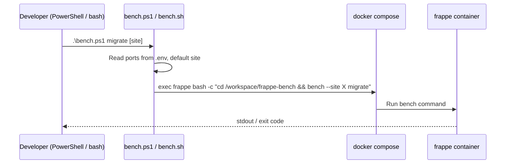

# F-002 — Bench Management CLI

| Field | Value |
| :--- | :--- |
| **ID** | F-002 |
| **Status** | ⚠️ Implemented (debt) |
| **Owner** | Ahmad |
| **Area** | DevEx |
| **Location** | [`bench.ps1`](../../../bench.ps1) (Windows), [`bench.sh`](../../../bench.sh) (Linux/macOS/WSL), `bench` (shim) |
| **Depends on** | F-001 |
| **Created** | 2026-10-15 |
| **Last updated** | 2026-10-23 |

---

## 1. Summary

Host-side wrapper that turns every common bench / docker operation into a single command, so developers
never need to remember `docker compose exec frappe bash -c "cd /workspace/frappe-bench && ..."`.

## 2. Architecture

## 3. Command Reference

| Group | Command | Action | Destructive? |
| :--- | :--- | :--- | :-- |
| Lifecycle | `up` / `down` / `ps` (`status`) / `bash` | Compose up/down/ps, interactive shell | — |
| Dev server | `start [-d]` / `stop` / `restart` | `honcho start socketio watch schedule worker web` (bg logs → `logs/honcho.log`); stop via `pkill` | stop kills processes |
| Workers | `worker status` / `worker restart` | `bench doctor`; `pkill -f worker` | — |
| Scheduler | `scheduler status\|enable\|disable [site]` | `bench doctor` / `enable-scheduler` / `disable-scheduler` | — |
| Backups | `backup [site]` | `bench backup --with-files` | — |
| | `restore <file> [site]` *(ps1 only)* | `bench restore` | ⚠️ Yes |
| Seed sync | `export-seed [site]` / `restore-seed [site]` | See F-004 | restore ⚠️ Yes |
| Apps | `new-app`, `get-app`, `install-app <app> [site]`, `uninstall-app <app> [site]` | Bench app management | uninstall ⚠️ Yes |
| Site | `migrate [site]`, `console [site]` | Migrate / interactive console | — |
| Redis | `redis info` / `redis flush` | Memory stats / `flushall` on both Redis | flush ⚠️ Yes |
| Ops | `logs`, `dashboard`, `exec <bench args>` | Tail honcho log, start F-003, passthrough | — |

## 4. Acceptance Criteria

| ID | Criterion |
| :-- | :--- |
| AC-1 | Every command in §3 works identically in `bench.ps1` and `bench.sh` (except documented gaps). |
| AC-2 | Ports are read from `.env` with documented defaults. |
| AC-3 | Optional `[site]` argument defaults to `development.localhost`. |

## 5. Known Issues / Tech Debt

| # | Item | Severity | Status |
| :-- | :--- | :--- | :--- |
| 1 | **`.\bench.ps1 start -d` ignores `-d`.** The script is an advanced script (`[Parameter()]`), so PowerShell binds `-d` to the common `-Debug` parameter and `$ArgsList` is empty → server starts in the foreground. Verified 2026-10-23. Fix: accept a `[switch]$Detach` or check `$PSBoundParameters['Debug']`. | Medium | Open |
| 2 | `exec`, `console`, `bash`, `new-app`, foreground `start` use `-it` → fail in non-TTY shells (AI agents, CI). Use `-T` for automation. | Medium | Open |
| 3 | DB root password hardcoded (`--db-root-password 123`) in `restore` / `restore-seed`; should read `DB_ROOT_PASSWORD` from `.env`. | Medium | Open |
| 4 | Default site hardcoded instead of read from `SITE_NAME` in `.env`. | Low | Open |
| 5 | `worker restart` uses `pkill -f 'worker'` — broad pattern can kill unrelated processes; workers are not respawned outside honcho. | Medium | Open |
| 6 | `bench.ps1 help` advertises `new-site` but no handler exists; `bench.sh` lacks `restore`. | Low | Open |
| 7 | No confirmation prompt for destructive commands (`restore*`, `redis flush`, `uninstall-app`). | Medium | Open |
| 8 | Arguments are interpolated unquoted into `bash -c` strings (injection / spaces). | Low (local) | Open |

## 6. Changelog

| Date | Version | Change | Author |
| :--- | :--- | :--- | :--- |
| 2026-10-15 | 1.0 | CLI created (PowerShell + bash) | Ahmad |
| 2026-10-23 | 1.0 | Spec documented retroactively; `-d` binding bug found | AI |
