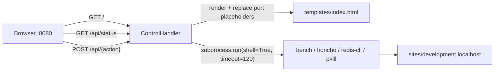

# F-003 — Web Control Center

| Field | Value |
| :--- | :--- |
| **ID** | F-003 |
| **Status** | ⚠️ Implemented (debt) |
| **Owner** | Ahmad |
| **Area** | DevEx |
| **Location** | [`dashboard/app.py`](../../../dashboard/app.py), [`dashboard/templates/index.html`](../../../dashboard/templates/index.html) |
| **Depends on** | F-001 (runs inside the `frappe` container), F-002 (`.\bench.ps1 dashboard` launcher) |
| **Created** | 2026-10-15 |
| **Last updated** | 2026-10-23 |

---

## 1. Summary

A zero-dependency (stdlib `http.server`) web GUI on port `8080` that exposes common bench operations —
status, backups/restores, dev server, workers, scheduler, Redis, apps, migrate — as buttons backed by a JSON API.

## 2. Architecture

## 3. API Contract

| Method | Path | Body | Action |
| :--- | :--- | :--- | :--- |
| GET | `/` | — | Dashboard HTML (`{{WEB_PORT}}`, `{{SOCKETIO_PORT}}`, `{{DASHBOARD_PORT}}` substituted) |
| GET | `/api/status` | — | Process flags (web/socketio/workers/scheduler/honcho), installed apps, backups list, `bench doctor` output, ports |
| POST | `/api/backup` | `{site?}` | `bench --site X backup --with-files` |
| POST | `/api/restore` | `{filename, site?}` | `bench --site X restore <backup>` ⚠️ |
| POST | `/api/server/start` | — | `nohup honcho start ...` |
| POST | `/api/server/stop` | — | `pkill` honcho / bench helper / socketio |
| POST | `/api/workers/restart` | — | `pkill -f worker` |
| POST | `/api/scheduler/toggle` | `{site?, enable}` | enable/disable scheduler |
| POST | `/api/redis/flush` | — | `flushall` on cache + queue ⚠️ |
| POST | `/api/apps/install` | `{app, site?}` | `install-app` |
| POST | `/api/apps/uninstall` | `{app, site?}` | `uninstall-app` ⚠️ |
| POST | `/api/migrate` | `{site?}` | `migrate` |

All responses: `{"success": bool, "stdout": str, "stderr": str}` (or a `message`).

## 4. Acceptance Criteria

| ID | Criterion |
| :-- | :--- |
| AC-1 | `.\bench.ps1 dashboard` serves the UI on `http://localhost:8080`. |
| AC-2 | `/api/status` reflects real process state within one refresh. |
| AC-3 | Each POST action returns the underlying command's stdout/stderr. |

## 5. Known Issues / Tech Debt

> [!CAUTION]
> This service must **never** be exposed beyond `127.0.0.1`. It is an unauthenticated remote shell by design.

| # | Item | Severity | Status |
| :-- | :--- | :--- | :--- |
| 1 | **Command injection:** `site`, `app`, `filename` from the JSON body are interpolated into `shell=True` commands. Fix: validate against allow-lists (installed sites/apps, existing backup files) and use argument lists without `shell=True`. | High | Open |
| 2 | No authentication / CSRF protection; `Access-Control-Allow-Origin: *` lets any website the developer visits trigger actions on `localhost:8080`. | High | Open |
| 3 | DB root password hardcoded in `/api/restore`. | Medium | Open |
| 4 | `DEFAULT_SITE` hardcoded to `development.localhost`. | Low | Open |
| 5 | Process detection uses substring matching on `ps aux` (`"worker" in ps_out`) → false positives. | Low | Open |
| 6 | `get_env_ports` swallows exceptions silently (`except Exception: pass`). | Low | Open |
| 7 | Logs are plain text, not JSON; no `/health` endpoint. | Low | Open |
| 8 | Server started with `nohup ... &` via `subprocess` — orphaned processes not tracked. | Low | Open |

## 6. Changelog

| Date | Version | Change | Author |
| :--- | :--- | :--- | :--- |
| 2026-10-15 | 1.0 | Control Center created | Ahmad |
| 2026-10-23 | 1.0 | Spec documented retroactively; security issues logged | AI |
