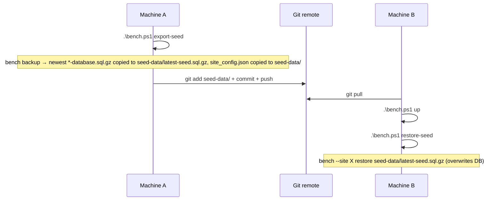

# F-004 — Seed State Sync

| Field | Value |
| :--- | :--- |
| **ID** | F-004 |
| **Status** | ⚠️ Implemented (debt) |
| **Owner** | Ahmad |
| **Area** | DevEx |
| **Location** | [`seed-data/`](../../../seed-data/README.md), CLI commands `export-seed` / `restore-seed` in F-002 |
| **Depends on** | F-002 |
| **Created** | 2026-10-15 |
| **Last updated** | 2026-10-23 |

---

## 1. Summary

Replicates the full database state of the dev site between machines (work PC ↔ home PC) by committing a
compressed SQL dump to the stack's Git repository.

## 2. Flow

## 3. Artefacts

| File | Content | Tracked in git |
| :--- | :--- | :-- |
| `seed-data/latest-seed.sql.gz` | Full DB dump of the site | Yes |
| `seed-data/site_config.json` | Copy of the site's `site_config.json` | Yes ⚠️ |
| `seed-data/README.md` | Usage notes | Yes |

## 4. Acceptance Criteria

| ID | Criterion |
| :-- | :--- |
| AC-1 | After `restore-seed` on a fresh machine, all DocTypes, records and settings from the source machine are present. |
| AC-2 | `export-seed` always picks the newest backup. |

## 5. Rules for AI Agents

- `restore-seed` **overwrites the entire site database** — requires explicit confirmation (see `ai-rules.md §4`).
- Never run `export-seed` unprompted; it changes a tracked binary file.
- Never read or print the contents of `seed-data/site_config.json`.

## 6. Known Issues / Tech Debt

| # | Item | Severity | Status |
| :-- | :--- | :--- | :--- |
| 1 | `seed-data/site_config.json` is tracked in git and contains `db_password` (verified 2026-10-23, keys only). It does **not** contain `encryption_key`, so once one is generated, Password fields in the dump won't decrypt on another machine. Keep the repo private, move secrets to git-crypt/SOPS or transfer out-of-band, and sync `encryption_key` the same way. | High | Open |
| 2 | DB dump may include PII / credentials; must not be pushed to a public repo. | High | Open |
| 3 | Binary dump in git bloats history on every export (consider Git LFS). | Medium | Open |
| 4 | Private/public **files** are not part of the seed (backup without `--with-files`) → attachments missing after restore. | Medium | Open |
| 5 | DB root password hardcoded in `restore-seed`. | Medium | Open |
| 6 | No schema/version check: restoring a seed from a different Frappe/ERPNext version requires a manual `migrate`. | Low | Open |

## 7. Changelog

| Date | Version | Change | Author |
| :--- | :--- | :--- | :--- |
| 2026-10-15 | 1.0 | Seed export/restore introduced | Ahmad |
| 2026-10-23 | 1.0 | Spec documented retroactively; secrets-in-git issue logged | AI |
