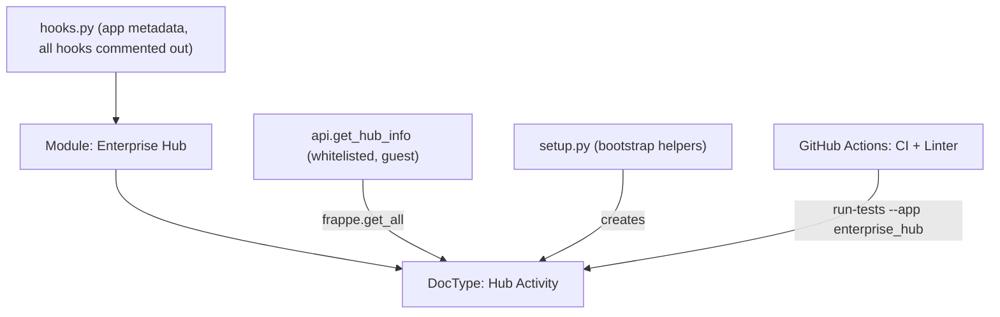

# F-005 — Enterprise Hub App Foundation

| Field | Value |
| :--- | :--- |
| **ID** | F-005 |
| **Status** | 🟢 Implemented (scaffold) |
| **Owner** | Ahmad |
| **Area** | App |
| **App / Module** | `enterprise_hub` / Enterprise Hub |
| **Location** | [`frappe-bench/apps/enterprise_hub/`](../../../frappe-bench/apps/enterprise_hub/README.md) (own git repo, branch `version-16`) |
| **Depends on** | F-001, `frappe` v16, `erpnext` v16 |
| **Created** | 2026-10-15 |
| **Last updated** | 2026-10-23 |

---

## 1. Summary

The custom Frappe app that hosts **all** business customisations for this system. Currently provides the
app scaffold, one sample DocType (`Hub Activity`), a verification API (`get_hub_info`), lint/format tooling,
and GitHub Actions CI.

## 2. Architecture

## 3. Data Model

### Hub Activity

| Property | Value |
| :--- | :--- |
| Module | Enterprise Hub |
| Type | Regular, not submittable |
| Naming | Default (hash) |
| Sort | `creation DESC` |
| Flags | `allow_rename`, `allow_bulk_edit`, `editable_grid` |

| Field | Fieldtype | Options | Reqd | In list view |
| :--- | :--- | :--- | :-- | :-- |
| `title` | Data | — | ✅ | ✅ |
| `status` | Select | `Pending` / `In Progress` / `Completed` | — | — |

**Permissions:** `System Manager` — full CRUD + email/export/print/report/share.

## 4. API Contract

| Method path | HTTP | Auth | Args | Returns |
| :--- | :--- | :--- | :--- | :--- |
| `enterprise_hub.api.get_hub_info` | GET/POST | **Guest allowed** | — | `{status, app, frappe_version, site, database, developer_mode, installed_apps, architecture, sample_records[{name,title,status}]}` |

## 5. Hooks

All hooks in `hooks.py` are currently the default commented-out template. **No** `doc_events`,
`scheduler_events`, `fixtures`, or overrides are active.

## 6. Tooling

| Tool | Config |
| :--- | :--- |
| Ruff (lint + format) | `pyproject.toml` — tabs, double quotes, line length 110, `py314` |
| Prettier + ESLint | `.pre-commit-config.yaml`, `.eslintrc` |
| CI | `.github/workflows/ci.yml` — MariaDB 11.8 + Redis services, Python 3.14, Node 24, `bench run-tests --app enterprise_hub` |
| Linter | `.github/workflows/linter.yml` |

## 7. Acceptance Criteria

| ID | Criterion |
| :-- | :--- |
| AC-1 | `enterprise_hub` is installed on `development.localhost` (`sites/apps.txt`). |
| AC-2 | `Hub Activity` list loads in Desk for System Manager. |
| AC-3 | `GET /api/method/enterprise_hub.api.get_hub_info` returns `status: "online"`. |
| AC-4 | CI passes on push to `version-16`. |

## 8. Known Issues / Tech Debt

| # | Item | Severity | Status |
| :-- | :--- | :--- | :--- |
| 1 | `get_hub_info` is `allow_guest=True` and exposes site name, Frappe version, installed apps, developer mode, and DB records to unauthenticated users (violates TR-53). Restrict to logged-in users or strip metadata. | High | Open |
| 2 | `get_hub_info` uses `frappe.get_all` (bypasses permissions) for guest-facing data (violates TR-41). | Medium | Open |
| 3 | `setup.py → create_sample_doctype()` creates a DocType at runtime, duplicating the shipped JSON (violates TR-30); `create_sample_activity()` calls `frappe.db.commit()` and `ignore_permissions` without justification. Remove or move to `after_install` / test fixtures. | Medium | Open |
| 4 | `test_hub_activity.py` contains no tests (`pass`); CI's "Find tests" step will not catch it. | Medium | Open |
| 5 | No `/health` / `/metrics` endpoint and no structured JSON logging yet (user standard §6). | Medium | Open |
| 6 | `export_python_type_annotations` not enabled (TR-23). | Low | Open |
| 7 | `app_email` is a placeholder (`developer@example.com`). | Low | Open |
| 8 | Recommended structure (`services/`, `api/`, `events/`, `tasks/`) from technical-rules §3 not yet created. | Low | Open |

## 9. Changelog

| Date | Version | Change | Author |
| :--- | :--- | :--- | :--- |
| 2026-10-15 | 0.0.1 | App scaffolded, Hub Activity DocType, get_hub_info API | Ahmad |
| 2026-10-23 | 0.0.1 | Spec documented retroactively | AI |
