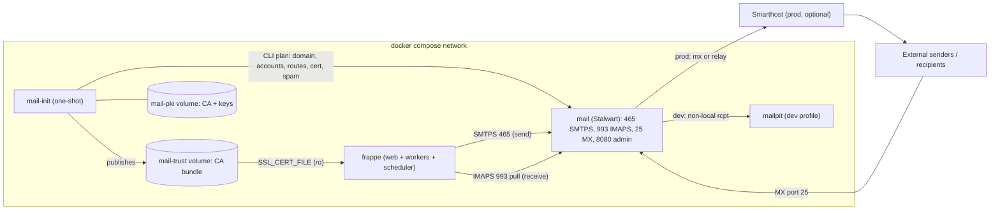
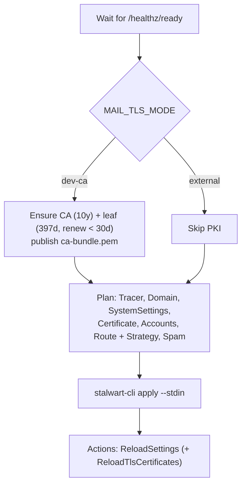

# F-006 — Self-Hosted Email (SMTP + IMAP) Integration

| Field | Value |
| :--- | :--- |
| **ID** | F-006 |
| **Status** | ✅ Implemented (dev verified) |
| **Owner** | Ahmad |
| **Area** | Infra + App |
| **App / Module** | `enterprise_hub` / `enterprise_hub.enterprise_hub.email_integration` |
| **Depends on** | F-001 (compose stack), F-005 (custom app) |
| **Created** | 2026-10-23 |
| **Last updated** | 2026-10-23 |

---

## 1. Summary

A self-hosted, open-source mail server (**Stalwart**) runs in the Docker stack. `enterprise_hub`
automatically provisions Frappe **Email Accounts** (outgoing + incoming) per site from configuration.
Fixes *"Unable to send mail because of a missing email account"*. Dev and production share one design;
only configuration changes.

## 2. Problem & Root Cause

`frappe.core.doctype.communication.email.make()` throws `OutgoingEmailError` when
`EmailAccount.find_outgoing()` finds nothing. Lookup order:

1. `Email Account` with `enable_outgoing=1, default_outgoing=1` → **none existed**
2. `mail_server` keys in `site_config.json` → **not set**
3. Dummy account (only if `mute_emails`) → **not set**

## 3. Goals / Non-goals

- **Goals**
  - G1: Mail server in Docker (SMTP submission + IMAP), free and open source.
  - G2: Email Accounts provisioned automatically and idempotently (install + every migrate), visible in Desk.
  - G3: Secrets never committed to git.
  - G4: In dev, mail can **never** reach real external recipients.
  - G5: Production-ready: TLS, spam filter, MX / smarthost outbound.
- **Non-goals**
  - Webmail for end users, newsletters, OAuth providers (M365/Gmail).

## 4. Decisions

| Decision | Choice | Why |
| :--- | :--- | :--- |
| Mail server | **Stalwart** `v0.16` (server 0.16.27) | Single container, SMTP+IMAP+JMAP, API-driven config (automatable per tenant), built-in spam/DKIM/ACME. |
| Dev catcher | **Mailpit** `v1.32.0` (`dev` profile) | All non-local recipients are relayed here (G4). |
| Dev domain | `hub.localhost` | `notifications@` (default outgoing), `support@` (incoming → Issue). |
| Provisioner | One-shot `mail-init` container (Stalwart CLI `1.0.13` + jq + openssl) | Declarative, idempotent, no secrets on disk. |
| Dev TLS | **Local dev CA** (`MAIL_TLS_MODE=dev-ca`) | Frappe v16 ignores *Validate SSL Certificate* for IMAP (always `ssl.create_default_context()`), so dev needs a trusted cert. Keeps TLS identical to prod. |

> [!WARNING]
> **Deliverability.** Outbound port 25 is blocked from this host (verified). Production needs **either** a
> VPS with port 25 + PTR + SPF/DKIM/DMARC (`MAIL_OUTBOUND_ROUTE=mx`) **or** a smarthost
> (`MAIL_OUTBOUND_ROUTE=relay`). Receiving internet mail needs an MX record and inbound port 25.

## 5. Architecture



### 5.1 Environments

| Concern | Dev | Production |
| :--- | :--- | :--- |
| Domain | `hub.localhost` | Tenant's real domain (`MAIL_DOMAIN`, `MAIL_HOSTNAME`) |
| Outbound external | `MAIL_OUTBOUND_ROUTE=mailpit` (UI `localhost:8025`) | `mx` or `relay` |
| TLS | `MAIL_TLS_MODE=dev-ca` + `MAIL_CLIENT_CA_BUNDLE` | `external` (ACME/manual cert in Stalwart); unset `MAIL_CLIENT_CA_BUNDLE` |
| Spam filter | `MAIL_SPAM_FILTER=disabled` (test senders have no SPF/DKIM → Junk) | `enabled` |
| Host ports | Loopback only (465, 993, admin 8090, Mailpit 8025) | Per infra policy |

### 5.2 Stalwart findings (v0.16)

| Finding | Handling |
| :--- | :--- |
| First start runs a bootstrap wizard | Pre-seed `/etc/stalwart/config.json` (`RocksDb` only) → normal mode. |
| Default listeners: 25, 465, 993, 995, 4190, 443, 8080 — **no 587/143** | Frappe uses 465 (`use_ssl_for_outgoing`) and 993 (`use_ssl`). |
| Admin port 8080 clashes with the dashboard (F-003) | Published as `MAIL_ADMIN_PORT=8090`. |
| `STALWART_RECOVERY_ADMIN` works in normal mode | Used as the automation credential (`admin:${MAIL_ADMIN_PASSWORD}`). |
| Default tracer writes to a missing `/var/log/stalwart` | `mail-init` reconciles the tracer to stdout. |
| Weak mailbox passwords are rejected | Generate strong secrets (24 random bytes, base64url). |
| `ReloadSettings` validates all routes | Relay secrets must exist in the `mail` container env (`MAIL_RELAY_PASSWORD`). |
| Unauthenticated external mail scored as spam → *Junk Mail* | `MAIL_SPAM_FILTER` toggle (dev only). |
| Mail from a site's own Email Account is skipped by Frappe (`SentEmailInInboxError`) | Expected Frappe behaviour; test inbound with external senders. |

## 6. Configuration Contract (per site)

Declared in `site_config.json` under `enterprise_hub_email`. **Passwords are never stored there**, only
the *name* of a secret (`password_env`). Resolution order: env var → `/run/secrets/<name lower>`.

```json
{
  "enterprise_hub_email": {
    "accounts": [
      {
        "email_id": "notifications@hub.localhost",
        "account_name": "Notifications",
        "smtp_server": "mail", "smtp_port": 465, "use_ssl_for_outgoing": 1,
        "enable_outgoing": 1, "default_outgoing": 1,
        "always_use_account_email_id_as_sender": 1,
        "password_env": "EH_MAIL_NOTIFICATIONS_PASSWORD"
      },
      {
        "email_id": "support@hub.localhost",
        "account_name": "Support",
        "email_server": "mail", "incoming_port": 993, "use_ssl": 1, "validate_ssl_certificate": 1,
        "enable_incoming": 1, "default_incoming": 1,
        "imap_folders": [{ "folder_name": "INBOX", "append_to": "Issue" }],
        "password_env": "EH_MAIL_SUPPORT_PASSWORD"
      }
    ]
  }
}
```

| Rule | Detail |
| :--- | :--- |
| Namespace | `enterprise_hub_email` only (legacy `mail_server` keys unused → one source of truth). |
| Validation | Allow-listed keys; unknown keys, plain `password`, invalid email, duplicate `email_id`/`account_name`, >1 default → `EmailConfigError`. |
| Identity | Upsert by `email_id`. `account_name` (autoname) is set on create only — renames stay manual. |
| Ownership | Keys present in config overwrite Desk on each sync; other fields are left alone. |
| Missing secret | Account saved with `awaiting_password=1` + Error Log; never raises. |
| `always_use_account_email_id_as_sender` | Required: Stalwart rejects a `From` that doesn't match the authenticated user. |

## 7. Implementation

### 7.1 Infra (stack repo)

| File | Purpose |
| :--- | :--- |
| [docker-compose.yml](../../../docker-compose.yml) | `mail`, `mail-init`, `mailpit` (dev profile); volumes `stalwart-data`, `mail-pki`, `mail-trust`; frappe gets `EH_MAIL_*`, `SSL_CERT_FILE`, trust mount. |
| [mail/stalwart/config.json](../../../mail/stalwart/config.json) | Pre-seeded datastore config (skips wizard). |
| [mail/init/Dockerfile](../../../mail/init/Dockerfile) | Alpine + pinned Stalwart CLI + jq/curl/openssl; non-root. |
| [mail/init/entrypoint.sh](../../../mail/init/entrypoint.sh) | Builds the NDJSON plan and applies it via stdin, then reloads settings/TLS. |
| [.env.example](../../../.env.example) | All `MAIL_*` / `EH_MAIL_*` variables (placeholders). |
| [.gitattributes](../../../.gitattributes) | LF for shell scripts. |

`mail-init` plan (every op is upsert/update/reconcile → idempotent):



### 7.2 App (`enterprise_hub`)

```text
enterprise_hub/
├── hooks.py                         ← after_install, after_migrate
└── enterprise_hub/email_integration/
    ├── config.py                    ← typed contract parsing/validation (EmailAccountSpec)
    ├── secret_resolvers.py          ← Strategy: Env / File (/run/secrets) / Chain / Static (tests)
    ├── provisioning.py              ← EmailAccountProvisioner + provision_from_site_config (Redis lock)
    ├── tasks.py                     ← enqueue (deduplicated job) + lifecycle hooks
    ├── api.py                       ← sync_email_accounts(), send_test_email() — System Manager, POST
    └── tests/ (test_config.py: 9 unit, test_provisioning.py: 8 integration)
```

| Component | Behaviour |
| :--- | :--- |
| `EmailAccountProvisioner` | Per-account savepoint; on error → rollback, `Error Log` (`Email Provisioning: <email>`), status `failed`, next account continues. No save when nothing changed. Password compared with the stored value (rotation supported). |
| `provision_from_site_config` | `frappe.cache.lock` per site (timeout 300s, wait 10s) → concurrent syncs return `skipped`. |
| Hooks | `after_install` / `after_migrate` → `frappe.enqueue(queue="short", job_id=..., deduplicate=True)`; never raise (migrate is never blocked). |
| Logging | `frappe.logger("enterprise_hub.email", allow_site=True)` JSON: `{event, site, email_id, status, account, message}`. |

## 8. Permissions & Tenant Isolation

- Config is per site → accounts isolated per tenant; lock key is site-scoped (`frappe.cache.make_key`).
- APIs: `@frappe.whitelist(methods=["POST"])` + `frappe.only_for("System Manager")`, typed args.
- Multi-site prod: name secrets per tenant (e.g. `EH_MAIL_<SITE>_SUPPORT_PASSWORD`).
- CA private key stays in `mail-pki` (mail-init only); clients get only the public bundle.

## 9. Operations

| Task | Command |
| :--- | :--- |
| Start / re-provision mail | `docker compose up -d --build mail mailpit mail-init` |
| Provisioner logs | `docker compose logs mail-init` |
| Re-sync Email Accounts | `bench --site <site> execute enterprise_hub.enterprise_hub.email_integration.api.sync_email_accounts` |
| Send test email | `... api.send_test_email --kwargs "{'recipient': 'x@example.com'}"` |
| Stalwart admin UI | `http://localhost:8090` (user `admin`, `MAIL_ADMIN_PASSWORD`) |
| Captured dev mail | `http://localhost:8025` |

## 10. Acceptance Criteria — verification (2026-10-23)

| ID | Criterion | Result |
| :-- | :--- | :--- |
| AC-1 | Default outgoing + incoming Email Accounts exist | ✅ `Notifications` (created), `Support` (created) via provisioner on `development.localhost` |
| AC-2 | Sending no longer raises "missing email account"; queue reaches `Sent` | ✅ `send_test_email` → Email Queue `Sent`, sender `Notifications <notifications@hub.localhost>`. ⚠️ Not clicked through the Sales Invoice UI. |
| AC-3 | External recipient captured in Mailpit, not delivered | ✅ `customer@example.com` message captured in Mailpit |
| AC-4 | Mail to `support@` creates an Issue | ✅ External sender via MX:25 → `ISS-2026-00002` (raised_by `omar.client@example.org`) |
| AC-5 | Re-sync is idempotent | ✅ Second run: both `unchanged`; integration test `test_rerun_is_idempotent` |
| AC-6 | `migrate` succeeds with mail down | ⚠️ By design (hook only enqueues, never raises; per-account isolation verified live when TLS failed). Full `migrate` with mail stopped **not executed**. |
| AC-7 | No mail password in tracked files | ✅ Scan of 74 tracked/untracked files in both repos: 0 matches |

Additional checks run: strict TLS (`VERIFY_X509_STRICT`) on IMAPS/SMTPS from the frappe container;
public HTTPS still works with the combined bundle; `ruff check` + `ruff format` clean; 17/17 tests on `test.localhost`.

## 11. Rollout & Rollback

- **Rollout:** set `.env` (see `.env.example`) → `docker compose up -d --build mail mailpit mail-init` →
  recreate frappe (`docker compose up -d frappe`) → set `enterprise_hub_email` → `bench migrate` (or `sync_email_accounts`).
- **Rollback:** remove `enterprise_hub_email`; accounts remain as plain records (disable in Desk). Stopping
  `mail` doesn't affect the rest of the stack. Unset `MAIL_CLIENT_CA_BUNDLE` to return frappe to system roots.

## 12. Risks & Open Questions

| # | Item | Severity | Status |
| :-- | :--- | :--- | :--- |
| 1 | Production domain + hosting (VPS port 25 vs smarthost) | Medium | Open |
| 2 | `site_config.json` of `development.localhost` is tracked in git (why secrets go via env) | High | Track in F-004 |
| 3 | Frappe's `SMTP_SSL` doesn't verify certificates (core behaviour) | Low | Accepted; IMAP is strictly verified |
| 4 | `mail-init` reconciles the Tracer each run (destroy + create) | Low | Cosmetic; converges |
| 5 | Stalwart config schema may change between minors → image/CLI tags pinned | Low | Mitigated |
| 6 | Production: per-tenant mailbox creation via Stalwart API from Frappe | — | Future feature |

## 13. Changelog

| Date | Version | Change | Author |
| :--- | :--- | :--- | :--- |
| 2026-10-23 | 0.1 | Draft created from root-cause analysis | AI |
| 2026-10-23 | 1.0 | Implemented: Stalwart + mail-init + Mailpit, dev CA TLS, spam toggle, `email_integration` module, tests; AC-1…AC-5, AC-7 verified | AI |
