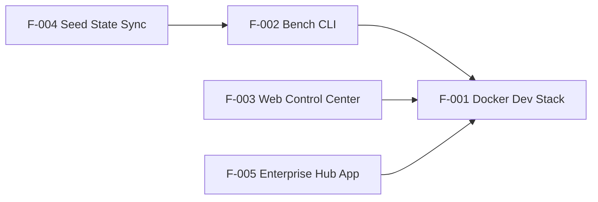

# 📋 Feature Registry

> Canonical list of features in this system. **Update this table whenever a spec is added or its status changes.**
> New feature? Copy [`_template/spec.md`](./_template/spec.md) into `F-<next-id>-<kebab-slug>/spec.md`.

## Status Legend

| Status | Meaning |
| :--- | :--- |
| 📝 Draft | Spec being written; no code yet |
| ✅ Approved | Spec approved; ready to implement |
| 🚧 In Progress | Implementation ongoing |
| 🟢 Implemented | Shipped; spec reflects current behaviour |
| ⚠️ Implemented (debt) | Shipped but has open issues listed in its spec |
| 🗄️ Deprecated | Kept for history; do not extend |

## Registry

| ID | Feature | Area | Status | Location | Spec |
| :-- | :--- | :--- | :--- | :--- | :--- |
| F-001 | Docker Dev Stack | Infra | ⚠️ Implemented (debt) | `docker-compose.yml`, `.env.example` | [spec](./F-001-docker-dev-stack/spec.md) |
| F-002 | Bench Management CLI | DevEx | ⚠️ Implemented (debt) | `bench.ps1`, `bench.sh` | [spec](./F-002-bench-cli/spec.md) |
| F-003 | Web Control Center | DevEx | ⚠️ Implemented (debt) | `dashboard/` | [spec](./F-003-web-control-center/spec.md) |
| F-004 | Seed State Sync | DevEx | ⚠️ Implemented (debt) | `seed-data/`, CLI `export-seed` / `restore-seed` | [spec](./F-004-seed-state-sync/spec.md) |
| F-005 | Enterprise Hub App Foundation | App | 🟢 Implemented | `frappe-bench/apps/enterprise_hub/` | [spec](./F-005-enterprise-hub-app/spec.md) |
| F-006 | Self-Hosted Email (SMTP + IMAP) | Infra + App | ✅ Implemented | `docker-compose.yml` (mail, mail-init, mailpit), `mail/`, `enterprise_hub/enterprise_hub/email_integration/` | [spec](./F-006-self-hosted-email/spec.md) |

## Dependency Graph

## Conventions

- **IDs** are sequential and never reused (`F-006`, `F-007`, …).
- **Folder name:** `F-XXX-<kebab-slug>/spec.md`; extra assets (diagrams, payload samples) live beside the spec.
- A feature is only `🟢 Implemented` when code, tests, and spec are all in sync.
