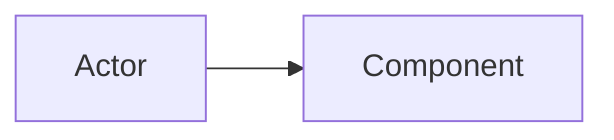

# F-XXX — <Feature Name>

> Copy this folder to `context/features/F-XXX-<kebab-slug>/` and fill every section.
> Delete guidance lines (in *italics*) once filled. Write `N/A` rather than deleting a section.

| Field | Value |
| :--- | :--- |
| **ID** | F-XXX |
| **Status** | Draft · Approved · In Progress · Implemented · Deprecated |
| **Owner** | <name> |
| **Area** | App · Infra · DevEx · Integration |
| **App / Module** | `enterprise_hub` / Enterprise Hub |
| **Depends on** | F-XXX, ERPNext module(s) … |
| **Created** | YYYY-MM-DD |
| **Last updated** | YYYY-MM-DD |

---

## 1. Summary

*One paragraph: what it does and who benefits.*

## 2. Problem & Goals

- **Problem:** …
- **Goals:**
  - G1 …
- **Non-goals:**
  - NG1 …

## 3. User Stories

| ID | As a… | I want… | So that… |
| :-- | :--- | :--- | :--- |
| US-1 | | | |

## 4. Functional Requirements

| ID | Requirement | Priority |
| :-- | :--- | :--- |
| FR-1 | | Must |

## 5. Architecture

*Explain which Frappe extension points are used and why (see technical-rules.md §2).*

## 6. Data Model

### 6.1 New DocTypes

| DocType | Type (Regular/Child/Single/Submittable) | Naming | Purpose |
| :--- | :--- | :--- | :--- |

| DocType | Field | Fieldtype | Options / Link | Reqd | Indexed | Notes |
| :--- | :--- | :--- | :--- | :-- | :-- | :--- |

### 6.2 Customisations on Existing DocTypes

| Target DocType | Kind (Custom Field / Property Setter) | Fieldname | Details | Shipped via |
| :--- | :--- | :--- | :--- | :--- |

### 6.3 Indexes

*List composite indexes added in `on_doctype_update()` or patches.*

## 7. API Contract

| Method path | HTTP | Auth / Roles | Args (typed) | Returns | Errors |
| :--- | :--- | :--- | :--- | :--- | :--- |
| `enterprise_hub.<module>.api.<fn>` | POST | | | | |

## 8. Hooks Touched (`hooks.py`)

| Hook | Key | Handler |
| :--- | :--- | :--- |
| `doc_events` | | |

## 9. Permissions & Tenant Isolation

- Roles & DocPerm matrix: …
- Row-level rules (`permission_query_conditions` / `has_permission` / User Permissions): …
- Tenant (site) isolation considerations: …

## 10. Background Jobs, Caching & Concurrency

| Concern | Design |
| :--- | :--- |
| Async jobs | queue, timeout, `job_id`, dedup |
| Cache | key, TTL, invalidation trigger |
| Locks | resource, mechanism |

## 11. UI / UX

*Desk form scripts, list views, workspace/dock entries, portal pages, PrimeVue SPA screens. Link designs.*

## 12. Migration & Patches

| Patch | Section (pre/post model sync) | Idempotent? | Purpose |
| :--- | :--- | :-- | :--- |

## 13. Observability

- Logs (logger name, key fields): …
- Error Log titles: …
- Metrics / health impact: …

## 14. Testing & Acceptance Criteria

| ID | Given / When / Then | Test file |
| :-- | :--- | :--- |
| AC-1 | | |

## 15. Rollout & Rollback

- Rollout steps: …
- Rollback: …

## 16. Risks, Open Questions & Known Issues

| # | Item | Severity | Status |
| :-- | :--- | :--- | :--- |

## 17. Changelog

| Date | Version | Change | Author |
| :--- | :--- | :--- | :--- |
| YYYY-MM-DD | 0.1 | Draft created | |
