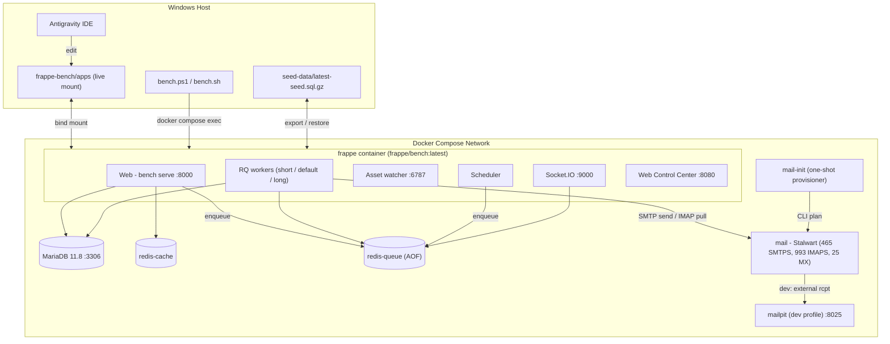
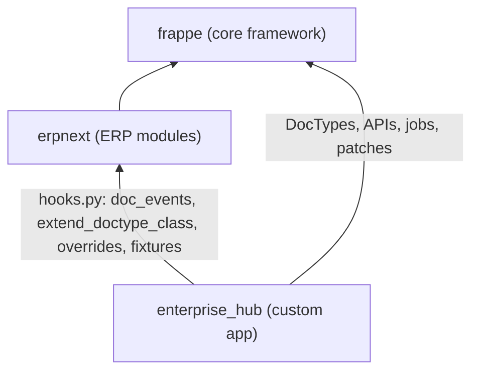
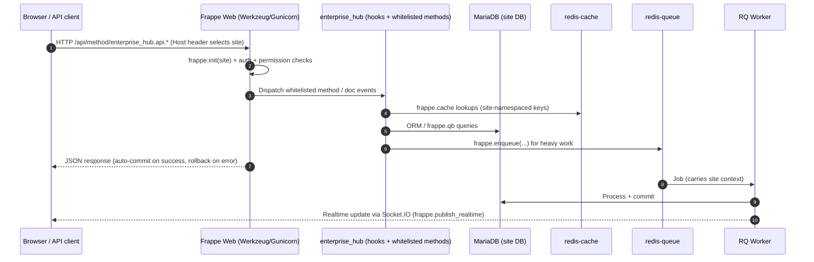
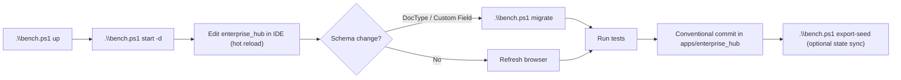

# 🏛️ Project Overview — Frappe & ERPNext v16 Enterprise Stack

> **Audience:** AI agents and engineers onboarding onto this repository.
> **Last reviewed:** 2026-10-23

---

## 1. What Is This System?

A **Docker-first, multi-tenant development platform** for building enterprise extensions on top of
**Frappe Framework v16** and **ERPNext v16**. All business logic is delivered through the custom app
**`enterprise_hub`** — the core `frappe` and `erpnext` apps are treated as **read-only upstream dependencies**.

| Attribute | Value |
| :--- | :--- |
| Framework | Frappe Framework `version-16` |
| ERP | ERPNext `version-16` |
| Custom app | `enterprise_hub` (module: **Enterprise Hub**, branch `version-16`) |
| Python / Node | Python `>=3.14`, Node `24` |
| Database | MariaDB `11.8` (`utf8mb4_unicode_ci`) |
| Cache / Queue | Redis (separate `redis-cache` and persistent `redis-queue`) |
| Runtime | `frappe/bench:latest` container, processes managed by `honcho` |
| Host OS | Windows + Antigravity IDE (code is live-mounted into the container) |
| Default site | `development.localhost` (`developer_mode: 1`) |

---

## 2. Repository Map

```text
frappe/                              ← Git repo: the dev stack itself
├── context/                         ← AI context (this folder)
├── docker-compose.yml               ← MariaDB, Redis x2, Frappe bench container
├── .env / .env.example              ← Ports, site name, DB/Redis endpoints (.env is git-ignored)
├── apps.json                        ← Declares apps for the bench (erpnext, enterprise_hub)
├── bench.ps1 / bench.sh             ← Host-side management CLI (wraps docker compose exec)
├── dashboard/                       ← Web Control Center (stdlib Python HTTP server, :8080)
│   ├── app.py
│   └── templates/index.html
├── seed-data/                       ← DB snapshot for cross-machine sync (tracked in git)
└── frappe-bench/                    ← Bench directory (mounted at /workspace/frappe-bench)
    ├── Procfile                     ← web, socketio, watch, schedule, worker
    ├── apps/
    │   ├── frappe/                  ← ⛔ Core framework  (READ-ONLY)
    │   ├── erpnext/                 ← ⛔ ERPNext         (READ-ONLY)
    │   └── enterprise_hub/          ← ✅ Custom app — ALL changes go here (own git repo)
    └── sites/
        ├── common_site_config.json
        └── development.localhost/   ← Site config, private/public files, backups
```

> [!IMPORTANT]
> `frappe-bench/apps/` is git-ignored by the stack repo. Each app (including `enterprise_hub`) is an
> **independent Git repository** published separately.

---

## 3. System Architecture

### 3.1 Runtime Topology



### 3.2 Application Layering (Frappe Extension Model)



**Rule of the stack:** `enterprise_hub` *extends* upstream behaviour through `hooks.py`, Custom Fields,
Property Setters and its own DocTypes. It never patches upstream source files.

### 3.3 Request Lifecycle



### 3.4 Multi-Tenancy Model

Frappe implements tenancy as **one site = one tenant = one database**. The site is resolved from the
HTTP `Host` header (or `--site` on the CLI). Isolation guarantees:

| Layer | Isolation mechanism |
| :--- | :--- |
| Database | Separate MariaDB schema per site (`site_config.json → db_name`) |
| Cache | `frappe.cache` keys are automatically prefixed with the site |
| Jobs | `frappe.enqueue` captures `frappe.local.site`; workers re-init that site |
| Files | `sites/<site>/public` and `sites/<site>/private` |
| Config | `site_config.json` overrides `common_site_config.json` |

---

## 4. Main Features

Full registry and status: [features/README.md](./features/README.md).

| ID | Feature | Area | Summary |
| :-- | :--- | :--- | :--- |
| F-001 | [Docker Dev Stack](./features/F-001-docker-dev-stack/spec.md) | Infra | MariaDB + Redis x2 + bench container, live-mounted source, health-checked DB |
| F-002 | [Bench Management CLI](./features/F-002-bench-cli/spec.md) | DevEx | `bench.ps1` / `bench.sh` wrapping every bench/docker operation |
| F-003 | [Web Control Center](./features/F-003-web-control-center/spec.md) | DevEx | Browser GUI on `:8080` for backups, workers, scheduler, Redis, apps |
| F-004 | [Seed State Sync](./features/F-004-seed-state-sync/spec.md) | DevEx | Export/restore DB snapshot through git for cross-machine parity |
| F-005 | [Enterprise Hub App Foundation](./features/F-005-enterprise-hub-app/spec.md) | App | Custom app scaffold, `Hub Activity` DocType, `get_hub_info` API, CI |
| F-006 | [Self-Hosted Email](./features/F-006-self-hosted-email/spec.md) | Infra + App | Stalwart mail server + auto-provisioned Email Accounts from `site_config` (`enterprise_hub_email`) |

---

## 5. Endpoints

| Service | URL | Notes |
| :--- | :--- | :--- |
| Desk (Frappe + ERPNext) | http://localhost:8000 | Dev credentials in `.env` (never hardcode) |
| Socket.IO | http://localhost:9000 | Realtime events |
| Asset watcher | http://localhost:6787 | Live reload |
| Web Control Center | http://localhost:8080 | Dev-only operations GUI |
| MariaDB | `127.0.0.1:3306` | All ports bound to loopback only |
| Mail submission / IMAP | `127.0.0.1:465` (SMTPS) / `127.0.0.1:993` (IMAPS) | F-006; dev TLS via local CA |
| Stalwart admin | http://localhost:8090 | F-006; user `admin`, password in `.env` |
| Mailpit (dev) | http://localhost:8025 | F-006; all external dev mail is captured here |
| Liveness | `GET /api/method/ping` | Built-in Frappe ping |
| App info | `GET /api/method/enterprise_hub.api.get_hub_info` | See F-005 |

---

## 6. Developer Workflow



---

## 7. Known Constraints & Tech Debt (Snapshot)

| Area | Observation | Tracked in |
| :--- | :--- | :--- |
| Config drift | `common_site_config.json` has `webserver_port: 8001` / `socketio_port: 9001`, while Procfile and `.env` use `8000` / `9000` | F-001 |
| Security | Dashboard runs shell commands with request input (`shell=True`), `CORS: *`, no auth | F-003 |
| Secrets | DB root password `123` hardcoded in CLI scripts & dashboard; `seed-data/site_config.json` (with `db_password`) is tracked in git | F-002, F-004 |
| Hardcoded tenant | `development.localhost` hardcoded in CLI + dashboard | F-002, F-003 |
| Observability | No `/health` or `/metrics` (Prometheus) endpoint in `enterprise_hub` yet; logging not JSON-structured | F-005 |
| Tests | `test_hub_activity.py` is an empty scaffold | F-005 |

> [!WARNING]
> This stack is a **development** environment. Nothing in F-002/F-003/F-004 is production-safe as-is.
