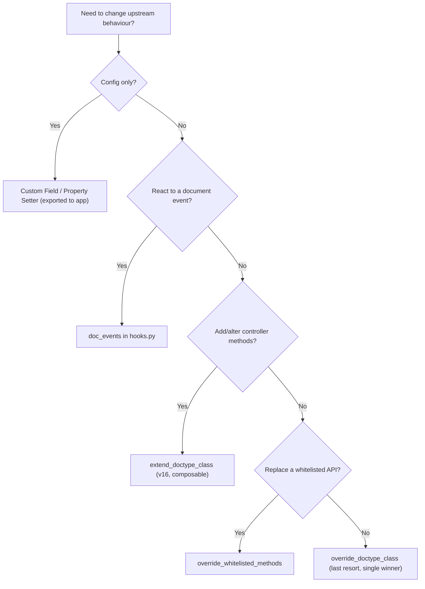

# ⚙️ Technical Rules — Frappe & ERPNext v16 Standards

> Engineering standards for all code in `frappe-bench/apps/enterprise_hub`.
> Rule IDs (`TR-xx`) are referenced by code reviews and by `ai-rules.md`.
> APIs cited here were verified against the local `version-16` source on 2026-10-23.

---

## 1. Golden Rules

| ID | Rule |
| :-- | :--- |
| TR-01 | **Never modify** `apps/frappe` or `apps/erpnext`. Extend via the custom app only. |
| TR-02 | Every schema change is **code** (DocType JSON, exported customisations, patches) — never manual DB edits or UI-only changes on a non-dev site. |
| TR-03 | Code must be **site-agnostic** (multi-tenant): no hardcoded site names, company names, users, or IDs. |
| TR-04 | Prefer framework primitives (ORM, `frappe.qb`, `frappe.cache`, `frappe.enqueue`, permissions) over custom infrastructure. |
| TR-05 | Readability and upgrade safety beat cleverness. |

---

## 2. Extension Points (Choose in This Order)



| ID | Rule |
| :-- | :--- |
| TR-10 | **Config first.** Field additions/changes on upstream DocTypes ⇒ Custom Field / Property Setter with `module = "Enterprise Hub"`, exported via *Customize Form → Export Customizations* (writes `enterprise_hub/<module>/custom/<doctype>.json`) or listed in `fixtures`. |
| TR-11 | **`doc_events`** for side-effects (validate, on_submit, on_cancel, on_trash). Handlers live in `enterprise_hub/<module>/events/<doctype>.py` with signature `def handler(doc, method=None)`. |
| TR-12 | **`extend_doctype_class`** (v16) to add/override controller methods. Multiple apps compose; always call `super()` in overridden lifecycle methods. |
| TR-13 | **`override_doctype_class`** only when extension is impossible — it replaces the class and only one app can win. Document the reason in the spec. |
| TR-14 | **`override_whitelisted_methods`** must keep the original signature and return shape. |
| TR-15 | Desk JS for upstream DocTypes ⇒ `doctype_js` / `doctype_list_js` in `hooks.py` pointing to files under `public/js/`. **Client Scripts** (DB records) are for prototyping only — port to the app before merge. |
| TR-16 | **Server Scripts** are not used for shipped features (not version-controlled, harder to test). |
| TR-17 | Sidebar / navigation: v16 **Dock** is authored in *Manage Dock* (developer mode) → *Export to App*; Workspaces are exported as JSON with the module. |

---

## 3. App Structure

```text
enterprise_hub/
├── hooks.py                     ← Single registry of all integrations
├── patches.txt                  ← [pre_model_sync] / [post_model_sync]
├── modules.txt                  ← "Enterprise Hub" (+ future modules)
├── enterprise_hub/              ← Module folder ("Enterprise Hub")
│   ├── doctype/<doctype>/       ← <dt>.json, <dt>.py, <dt>.js, test_<dt>.py
│   ├── custom/                  ← Exported Custom Fields / Property Setters
│   ├── api/                     ← Whitelisted endpoints, grouped by domain
│   ├── services/                ← Business logic (pure Python, testable)
│   ├── events/                  ← doc_events handlers (thin → call services)
│   ├── tasks/                   ← Scheduler / background job entrypoints
│   └── workspace/               ← Exported workspaces
├── patches/v1_0/                ← Patch modules
└── public/{js,css,scss}/        ← Desk assets (bundled by bench build)
```

| ID | Rule |
| :-- | :--- |
| TR-20 | **Thin controllers, fat services.** DocType controllers, `doc_events`, and API functions delegate to `services/` (Service / Repository pattern). |
| TR-21 | One responsibility per module; no circular imports between `services` and `doctype` controllers. |
| TR-22 | Constants (status values, role names, cache keys) in a `constants.py`, never inline magic strings. |
| TR-23 | Enable `export_python_type_annotations = True` in `hooks.py` so controllers get typed fields. |

---

## 4. DocType Design

| ID | Rule |
| :-- | :--- |
| TR-30 | Create DocTypes in Desk with `developer_mode: 1` and `custom: 0` so JSON is written to the app. Never create via `frappe.get_doc({"doctype": "DocType", ...})` at runtime. |
| TR-31 | Naming: Title Case singular (`Hub Activity`); fieldnames `snake_case`; prefer *naming series* or `format:` rules over random hashes for business documents. |
| TR-32 | Use `Link` fields (not `Data`) for references; `Dynamic Link` only when the target DocType truly varies. |
| TR-33 | Set `search_index: 1` on fields used in filters/joins. Composite indexes go in a module-level `on_doctype_update()` in the controller file using `frappe.db.add_index(doctype, [fields])`. |
| TR-34 | Use **Submittable** (`is_submittable`) for documents with legal/financial finality; never allow editing after submit — use cancel + amend. |
| TR-35 | Validation in `validate()`; side-effects in `on_update` / `on_submit`; never write other documents inside `validate()`. |
| TR-36 | Child tables for 1-to-many owned data; separate DocTypes + Link for shared/independent entities. |
| TR-37 | Hand-edited DocType JSON ⇒ bump `"modified"` or `bench migrate` will skip it. |

---

## 5. Database & Query Rules

| ID | Rule |
| :-- | :--- |
| TR-40 | **No `SELECT *`.** Always pass explicit `fields=[...]` to `frappe.get_all` / `frappe.get_list` / `frappe.qb`. |
| TR-41 | `frappe.get_list` (permission-aware) for user-facing data; `frappe.get_all` only in trusted server contexts. |
| TR-42 | **v16:** SQL functions as strings in `fields` are rejected. Use dict syntax: `fields=["status", {"COUNT": "*", "as": "total"}]`, or `frappe.qb` with `frappe.query_builder.functions`. |
| TR-43 | Raw SQL (`frappe.db.sql`) only when ORM/qb cannot express it; always parameterised (`%(name)s`), never f-strings/concatenation. |
| TR-44 | **No N+1.** Never `frappe.get_doc` in a loop to read data — batch with `get_all(... filters={"name": ["in", names]})`. Use `frappe.get_cached_doc` / `frappe.get_cached_value` for master data. |
| TR-45 | Use `frappe.db.get_value(..., ["a", "b"], as_dict=True)` for single-row reads instead of loading full documents. |
| TR-46 | Bulk writes: `frappe.db.bulk_insert` / `frappe.qb.update` in patches and jobs; respect that these bypass controllers. |
| TR-47 | Run `EXPLAIN` on any new query joining ≥ 2 tables or scanning large DocTypes (`GL Entry`, `Stock Ledger Entry`, `Version`, logs). |
| TR-48 | **Never call `frappe.db.commit()`** in request handlers or doc events — the framework commits per request. Allowed in patches/jobs for batched work (commit every N rows). |

---

## 6. Whitelisted APIs

```python
import frappe
from frappe import _


@frappe.whitelist(methods=["POST"])
def approve_activity(name: str, remarks: str | None = None) -> dict:
	"""Approve a Hub Activity. Requires write permission on the document."""
	doc = frappe.get_doc("Hub Activity", name)
	doc.check_permission("write")
	return services.activity.approve(doc, remarks=remarks)
```

| ID | Rule |
| :-- | :--- |
| TR-50 | Always restrict `methods=[...]`: `GET` for reads, `POST` for mutations. |
| TR-51 | Type-annotate every argument — v16 validates argument types from annotations. |
| TR-52 | Enforce permissions explicitly: `doc.check_permission(ptype)`, `frappe.has_permission(...)`, or `frappe.only_for(roles)`. |
| TR-53 | `allow_guest=True` requires spec approval, rate limiting (`@frappe.rate_limit`), and must never expose site/system metadata. |
| TR-54 | Return plain dicts/lists (JSON-serialisable); paginate list endpoints (`limit_start`, `limit_page_length`). |
| TR-55 | API paths are a contract: keep them stable; version breaking changes (`api/v2/...`) and record them in the spec. |

---

## 7. Background Jobs, Caching & Concurrency

### 7.1 Jobs

```python
frappe.enqueue(
	"enterprise_hub.enterprise_hub.tasks.sync.sync_company",
	queue="long",
	timeout=1500,
	job_id=f"sync_company::{company}",
	deduplicate=True,
	enqueue_after_commit=True,
	company=company,
)
```

| ID | Rule |
| :-- | :--- |
| TR-60 | Anything > ~1–2 s, external I/O, or bulk processing ⇒ `frappe.enqueue`. Choose `short` / `default` / `long` deliberately. |
| TR-61 | Pass `job_id` + `deduplicate=True` for idempotent jobs; use `enqueue_after_commit=True` when the job reads data written in the current transaction. |
| TR-62 | Jobs must be **idempotent** and pass **names, not documents**, as arguments (re-fetch inside the job). |
| TR-63 | Scheduled work via `scheduler_events` (`hourly`, `daily`, `cron`) — entrypoints in `tasks/`; heavy schedulers must enqueue rather than run inline. |
| TR-64 | Notify users of job results with `frappe.publish_realtime(event, message, user=...)`. |

### 7.2 Caching

| ID | Rule |
| :-- | :--- |
| TR-65 | Use `frappe.cache` (site-namespaced automatically). `frappe.cache.set_value(key, val, expires_in_sec=...)` / `get_value(key, generator=...)`. |
| TR-66 | Function memoisation: `@redis_cache(ttl=...)` (cross-process), `@site_cache(ttl=...)` (per-process), `@request_cache` (per request) from `frappe.utils.caching`. |
| TR-67 | Every cache entry has a TTL **and** an invalidation trigger (e.g. `on_update` clears the key). Never cache permission-dependent data without the user in the key (`user=True`). |
| TR-68 | Never use module-level globals as caches — they leak across sites in the same worker. Use `frappe.local` for per-request state. |

### 7.3 Locks

| ID | Rule |
| :-- | :--- |
| TR-69 | Distributed lock across workers: redis-py lock on the site-scoped key — `with frappe.cache.lock(frappe.cache.make_key("eh:lock:<resource>"), timeout=60, blocking_timeout=5):`. |
| TR-70 | Single-host critical sections may use `frappe.utils.synchronization.filelock(name, timeout=...)`. |
| TR-71 | Row-level concurrency: `frappe.db.get_value(..., for_update=True)` or `doc.lock()`; rely on `modified` timestamp checks for optimistic concurrency. |

---

## 8. Multi-Tenancy & Security

| ID | Rule |
| :-- | :--- |
| TR-80 | Resolve site only via `frappe.local.site`; files via `frappe.get_site_path(...)`; config via `frappe.conf`. |
| TR-81 | Secrets live in `site_config.json` / environment, read through `frappe.conf.get("key")` or **Password** fields (`doc.get_password("field")`). Never in code, fixtures, or git. |
| TR-82 | Row-level security via `permission_query_conditions` + `has_permission` hooks or User Permissions — not by filtering in the UI. |
| TR-83 | `ignore_permissions=True` only in system contexts (jobs, patches, installers) with a justifying comment. |
| TR-84 | Escape output in Jinja/HTML (`frappe.utils.escape_html`); never build HTML from user input in JS without `frappe.utils.escape_html` / `__()` placeholders. |
| TR-85 | Every multi-company feature filters by `company` and respects the user's default company (`frappe.defaults.get_user_default("Company")`). |

---

## 9. ERPNext-Specific Rules

| ID | Rule |
| :-- | :--- |
| TR-90 | **Ledgers are immutable.** Never insert/update `GL Entry`, `Stock Ledger Entry`, `Payment Ledger Entry` directly. Create/submit the source voucher (Journal Entry, Stock Entry, …) or use ERPNext controllers (`make_gl_entries`, `make_sl_entries`) from a submittable controller. |
| TR-91 | Extend transactions via the controller hierarchy (`AccountsController`, `StockController`, `SellingController`, `BuyingController`) using `extend_doctype_class`, never by copying logic. |
| TR-92 | Analytic dimensions ⇒ **Accounting Dimensions**, not ad-hoc Custom Fields on GL Entry. |
| TR-93 | Valuation / back-dated stock changes go through **Repost Item Valuation**; never recompute stock values manually. |
| TR-94 | Use ERPNext utilities instead of reimplementing: `erpnext.get_default_company()`, `get_exchange_rate`, `get_fiscal_year`, `get_balance_on`, item price / pricing-rule APIs. |
| TR-95 | Respect submit/cancel/amend lifecycle: custom logic on `on_submit` must have a symmetric `on_cancel` reversal. |
| TR-96 | Respect ERPNext settings DocTypes (Accounts/Stock/Selling/Buying Settings) instead of hardcoding behaviour; add new toggles in an `Enterprise Hub Settings` Single DocType. |
| TR-97 | Reports: prefer **Script Reports** (Python + JS in the app) with indexed filters; Query Reports only for simple read-only SQL. |

---

## 10. Migrations & Patches

| ID | Rule |
| :-- | :--- |
| TR-100 | Data migrations are patches in `patches/v<major>_<minor>/<name>.py` with `def execute():`, registered in `patches.txt`. |
| TR-101 | `[pre_model_sync]` for work needing the *old* schema (e.g. renaming/copying a column before it is dropped); `[post_model_sync]` for everything else. |
| TR-102 | Patches must be **idempotent** (guard with `frappe.db.has_column`, `frappe.db.exists`, etc.) and batched for large tables. |
| TR-103 | Patches are append-only; never edit a patch that has shipped — add a new one. |
| TR-104 | Field renames ⇒ `frappe.model.utils.rename_field.rename_field` in a patch, not manual SQL. |

---

## 11. Observability & Error Handling

| ID | Rule |
| :-- | :--- |
| TR-110 | Logger: `logger = frappe.logger("enterprise_hub", allow_site=True)`; log structured dicts including `site`, `user`, `request_id`/`job_id`, and domain IDs. |
| TR-111 | Unexpected errors: `frappe.log_error(title="<Feature>: <short>", message=frappe.get_traceback())` then re-raise. |
| TR-112 | User-facing errors: `frappe.throw(_("Readable message"), exc=frappe.ValidationError, title=_("Title"))` — no stack traces or SQL in messages. |
| TR-113 | Never `except Exception: pass`. Catch the narrowest exception; let unknown errors propagate so the request rolls back. |
| TR-114 | Health: `GET /api/method/ping` is the liveness probe. New services must expose readiness/metrics endpoints as defined in their spec (Prometheus format). |
| TR-115 | Register noisy log DocTypes in `default_log_clearing_doctypes` with a retention period. |

---

## 12. Frontend

| ID | Rule |
| :-- | :--- |
| TR-120 | Desk forms: `frappe.ui.form.on("<DocType>", { refresh(frm) {...} })`; server calls via `frappe.call` / `frm.call` with `freeze` for mutations. |
| TR-121 | Desk dialogs: `frappe.ui.Dialog`; don't build custom modals. |
| TR-122 | Standalone SPAs (portal / dashboards) in Vue 3 + **PrimeVue** + Pinia, lazily loaded routes, built through `bench build`. |
| TR-123 | Styling via CSS variables / theme tokens only (`var(--primary-color)`, Frappe's `--*` desk variables); no inline styles or hardcoded hex/px. |
| TR-124 | All strings translatable: `__("Text {0}", [value])`. |

---

## 13. Testing

```python
from frappe.tests import IntegrationTestCase, UnitTestCase


class UnitTestHubActivity(UnitTestCase):
	def test_status_default(self): ...


class IntegrationTestHubActivity(IntegrationTestCase):
	def test_insert_requires_title(self):
		with self.assertRaises(frappe.MandatoryError):
			frappe.get_doc({"doctype": "Hub Activity"}).insert()
```

| ID | Rule |
| :-- | :--- |
| TR-130 | Use `frappe.tests.UnitTestCase` (no DB writes) and `IntegrationTestCase` (DB, auto-rollback). `FrappeTestCase` is legacy. |
| TR-131 | Each DocType has `test_<doctype>.py`; each service has unit tests; each API has a permission test (allowed + denied). |
| TR-132 | Run: `.\bench.ps1 exec --site <test-site> run-tests --app enterprise_hub [--module <dotted.path>]` on a site with `allow_tests: true`. |
| TR-133 | Tests create their own fixtures; never depend on seed data or record names from a dev site. |

---

## 14. Code Style & Tooling

| ID | Rule |
| :-- | :--- |
| TR-140 | Python: **ruff** (lint + format) per `pyproject.toml` — tabs, double quotes, line length 110, target `py314`. |
| TR-141 | JS/Vue/SCSS: **prettier** + **eslint** per `.pre-commit-config.yaml`. |
| TR-142 | Install hooks once: `pre-commit install` inside the app repo; CI (`.github/workflows/ci.yml`) must stay green. |
| TR-143 | Commits: Conventional Commits (`feat(hub): ...`, `fix(api): ...`, `chore(deps): ...`). |
| TR-144 | Docstrings on public functions: purpose, args, returns, raised exceptions. |

---

## 15. Quick Reference — Dev Commands

> [!NOTE]
> `.\bench.ps1 exec` uses `docker compose exec -it`, which fails in non-TTY shells (AI agents, CI).
> For automation use: `docker compose exec -T frappe bash -c "cd /workspace/frappe-bench && bench <args>"`.

| Task | Command (PowerShell, from repo root) |
| :--- | :--- |
| Apply schema changes | `.\bench.ps1 migrate` |
| Clear cache | `.\bench.ps1 exec --site development.localhost clear-cache` |
| Build assets | `.\bench.ps1 exec build --app enterprise_hub` |
| Run tests | `.\bench.ps1 exec --site <test-site> run-tests --app enterprise_hub` |
| Export fixtures | `.\bench.ps1 exec --site development.localhost export-fixtures --app enterprise_hub` |
| Console (interactive, humans only) | `.\bench.ps1 console` |
| Worker / scheduler health | `.\bench.ps1 worker status` |
